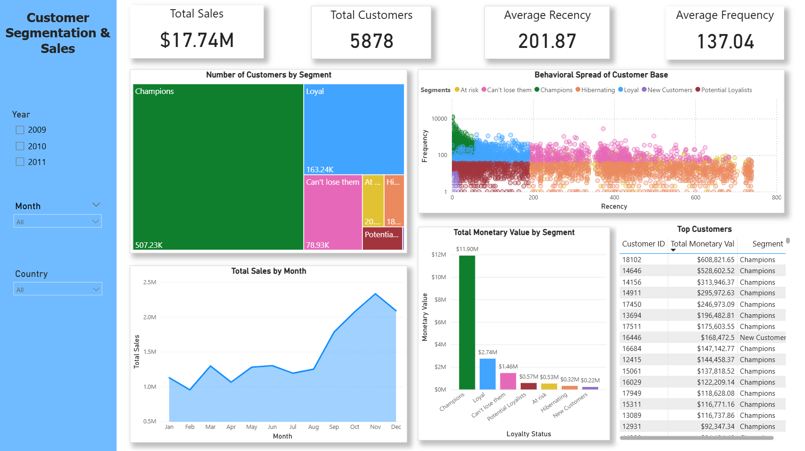

# RFM Customer Analytics & Revenue Segmentation

## Project Overview
In highly saturated retail markets, retaining high-value customers is vastly more profitable than acquiring new ones. This project is an end-to-end data pipeline and Business Intelligence solution designed to help marketing and sales teams identify churn risks, allocate marketing budgets, and understand customer purchasing behavior.

By extracting raw transactional data from a **PostgreSQL** database, I engineered a custom **RFM (Recency, Frequency, Monetary)** scoring model using SQL. The transformed data was then visualized in an interactive **Power BI** dashboard to provide actionable executive insights and dynamic targeting lists.

---

## Tech Stack & Tools
* **Database Management:** PostgreSQL, pgAdmin
* **Data Engineering & Transformation:** SQL (Window Functions, CTEs, CASE WHEN logic)
* **Data Visualization & Analytics:** Power BI, DAX, Data Modeling
* **Techniques Used:** RFM Analysis, Logarithmic Scaling, Cross-filtering, Dashboard Design

---

## Methodology: The Data Pipeline
### 1. Data Prep & Cleaning (Python)
Raw transactional data was first processed using a Jupyter Notebook (`notebooks/data_prep.ipynb`). This stage involved handling missing values, standardizing date formats, removing cancelled orders, and ensuring data integrity before database insertion.

### 2. The RFM Model (SQL)
To segment the customer base, I wrote custom SQL scripts to evaluate every customer across three behavioral metrics:
* **Recency:** Days since their last purchase.
* **Frequency:** Total number of distinct orders placed.
* **Monetary Value:** Total lifetime revenue generated by the customer.

Customers were assigned a score from 1 to 5 for each category. Using complex `CASE WHEN` logic, I grouped them into distinct, actionable cohorts:
* **Champions:** Bought recently, buy often, and spend the most.
* **Loyal:** Consistent buyers with above-average spend.
* **Can't Lose Them:** Historically massive spenders who have not returned recently (High churn risk).
* **Hibernating / At Risk:** Low frequency and low spend; currently lapsed.

---

## Key Business Insights
The dashboard moves beyond standard reporting by revealing actionable business realities:

1. **The Pareto Principle in Action (80/20 Rule):** 
   While the business has generated **$17.74M** from **5,878** total customers, the "Champions" segment alone accounts for **$11.90M** (approx. 67%) of total revenue. Retention strategies must fiercely protect this cohort.
2. **Quantifying Churn Risk:** 
   The visual treemap highlights a significant "Can't Lose Them" cohort. These are previously high-LTV (Lifetime Value) customers whose recency has lapsed. A targeted win-back email campaign for this specific group could immediately recapture lost baseline revenue.
3. **Severe Q4 Seasonality:** 
   The Area Chart reveals a massive spike in order volume beginning in September and peaking in November. Marketing teams must allocate their largest acquisition budgets to late summer to maximize ROAS (Return on Ad Spend) before the Q4 wave hits.
4. **Actionable Pipeline Generation:** 
   The dashboard includes a dynamic "VIP Target List" matrix. If a sales manager selects the "At Risk" segment, the table instantly filters to output the specific `customer_id`s and historical monetary values of those users for immediate outreach.

---

## Repository Structure
* `/data` - Cleaned and raw datasets (`cleaned_online_retail.csv`, etc.)
* `/notebooks` - Python Jupyter notebooks used for initial data cleaning (`data_prep.ipynb`).
* `/sql` - Contains the PostgreSQL scripts (`DDL.sql`, `rfm_calculation.sql`, `rfm_scoring.sql`, `rfm_segment.sql`).
* `/dashboard` - Contains the `.pbix` Power BI file and a static PDF export of the final dashboard.
* `/images` - High-resolution screenshots of the dashboard and underlying data model.
